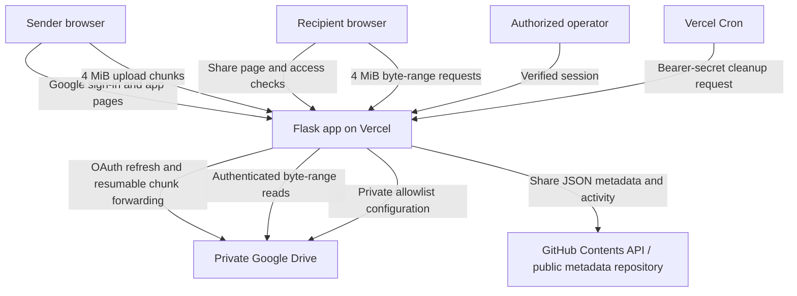

# QuickShare Cloud

QuickShare Cloud is a QR-code and expiring-link file-sharing web application built with Flask, Google OpenID Connect, GitHub's Contents API, Google Drive, and Vercel. It is designed as a cloud-computing mini-project and supports private central Drive storage, small public GitHub storage, per-user share management, and resumable large-file transfers without a separate VPS.

> **Important:** “5 GB” and “50 GB” are application per-file limits, not a promise of unlimited storage or bandwidth. Google Drive quota, Google API policy, Vercel function usage, execution limits, and browser capabilities still apply.

## Contents

- [Features](#features)
- [Architecture](#architecture)
- [How uploads work](#how-uploads-work)
- [How downloads work](#how-downloads-work)
- [Storage and metadata model](#storage-and-metadata-model)
- [Upload tiers and permissions](#upload-tiers-and-permissions)
- [Local development](#local-development)
- [Production deployment](#production-deployment)
- [Environment variables](#environment-variables)
- [Google OAuth and Drive setup](#google-oauth-and-drive-setup)
- [Routes and APIs](#routes-and-apis)
- [Security and privacy](#security-and-privacy)
- [Limits and known trade-offs](#limits-and-known-trade-offs)
- [Troubleshooting](#troubleshooting)
- [Tests](#tests)

## Features

- Google sign-in using OpenID Connect.
- My Shares dashboard: users can manage only the shares associated with their own authenticated Google account.
- Google Drive private storage, using one centrally configured Drive account for the application's users.
- GitHub storage as an optional alternative for small files; GitHub-stored file contents are public.
- Resumable, chunked upload: standard accounts can upload files up to **5 GB**; accounts explicitly approved by the administrator can upload files up to **50 GB**.
- Upload progress feedback, bounded chunks, retries, and server-side validation.
- Large-file downloads in 4 MiB byte ranges, written directly to a file selected by the recipient in supported desktop browsers.
- Share pages and QR codes; recipients do not need to sign in merely to download a valid share.
- Configurable expiry (10 minutes, 1 hour, 24 hours, or 7 days), download limits (1, 3, 5, or 10), share revocation, activity summaries, and cleanup.
- Privileged configuration actions use verified-account checks on the server.
- CSRF checks for state-changing requests, signed upload/download tickets, upload-finalization verification, and automated tests.

## Architecture

QuickShare deliberately separates the **control plane** (authentication, share metadata, policy checks) from the **file-data path** (small bounded chunks). It does not create one enormous HTTP request containing a multi-gigabyte file.



### Main components

| Component | Responsibility |
|---|---|
| `app.py` | Flask routes, authentication, CSRF validation, upload/download ticket handling, share policy, privileged-access checks, and API responses. |
| `services/google_drive_storage.py` | Refreshes Google OAuth access tokens, creates the private application folder, starts resumable uploads, forwards chunks, validates finished files, reads byte ranges, manages the private permission file, and deletes Drive files. |
| `services/github_storage.py` | Reads and updates share metadata through the GitHub Contents API, serves GitHub-hosted public files, records download activity, revokes shares, and runs cleanup. |
| `templates/` | Server-rendered HTML pages, including the upload UI, share page, My Shares dashboard, storage settings, and large-download page. |
| `static/js/app.js` | Client-side upload chunking, retries, progress, copy/share actions, and local-file large-download logic. |
| `static/css/` | Main styles and responsive UI enhancements. |
| `vercel.json` | Configures a daily Vercel Cron invocation of the cleanup endpoint. |
| `tests/` | Flask-route, permission, chunk-transfer, Drive-storage, and other automated tests. |

## How uploads work

### Small GitHub uploads

The GitHub storage option is kept for demos and small files. The upload is written to the configured GitHub storage repository using the Contents API. Those file bytes are public, even if a QuickShare share later expires or is revoked. Do not use GitHub storage for private files.

### Google Drive uploads (4 MiB chunks)

For larger files, the browser and server follow this workflow:

1. **Check the request.** The signed-in user's file size, file extension, expiry choice, download limit, and permission tier are validated on the server.
2. **Create an upload session.** QuickShare uses the administrator's Drive OAuth credentials to create a Google Drive resumable-upload session. The app stores the upload metadata, owner hash, upload nonce, session URL, and permitted byte limit inside a signed upload ticket.
3. **Slice locally.** The sender's browser uses the File API to slice the original local file into chunks of at most 4 MiB. No independent temporary packet files are created on the user's disk.
4. **Forward one chunk at a time.** The browser posts each chunk to the same-origin `/api/uploads/chunk` endpoint. The Vercel function forwards the bytes to Google's resumable-upload URL and returns the acknowledged offset. The browser retries transient failures and resumes from the acknowledged offset.
5. **Verify finalization.** After Google reports completion, QuickShare asks Drive for the uploaded file's metadata and checks the file ID, actual size, parent folder, share ID and upload nonce.
6. **Create the share record.** Only after verification does the app persist the share metadata in the GitHub metadata repository and redirect the sender to the share page.

Google Drive assembles its received resumable-upload chunks into one normal Drive file. QuickShare does not upload a folder of packet files and does not run a reconstruction process on a VPS.

## How downloads work

### Files up to 4 MiB

The normal download route retrieves the selected file through the appropriate storage provider after checking the share status and access rules.

### Larger private Google Drive files

1. Opening a large-file link displays the dedicated download page.
2. The recipient clicks **Save file to your device**. In compatible desktop Edge or Chrome, the browser asks the recipient to select a destination file.
3. QuickShare creates a signed, time-limited download ticket and reserves the share's download allowance.
4. The browser requests 4 MiB ranges from `/api/download/chunk`. The server validates the signed ticket and requested byte range, then reads the corresponding range from private Drive storage.
5. The browser writes each returned range at its correct byte offset in the chosen local file, so the entire file does not have to be held in browser memory.
6. The client refreshes the ticket during a long transfer. Ticket refresh checks that the share still exists, has not expired or been revoked, and still refers to the same Drive file.

The recipient does not need to log in to the storage administrator's Google account, and QuickShare does not make the Drive file publicly accessible.

## Storage and metadata model

QuickShare intentionally keeps the current metadata store separate from the file contents.

### Google Drive provider

- File contents live in a private folder named **QuickShare Cloud Storage** in the connected administrator's Drive (unless `GOOGLE_DRIVE_FOLDER_ID` points to a configured folder).
- Uploads and reads use server-held OAuth credentials. The private file itself is not shared publicly with recipients.
- An authorized recipient downloads through QuickShare's gated routes rather than a public Drive URL.
- The allowlist for 50 GB uploads is stored as a JSON configuration file in the private application Drive folder.

### GitHub provider

- File contents are stored in the configured GitHub repository and are public.
- QuickShare link expiry/revocation cannot prevent someone from accessing a public GitHub file directly if they have its raw repository URL.
- Use this option only for files that are safe to publish.

### Share metadata

For both storage providers, share metadata is stored as JSON in the configured GitHub repository, which is public in the current deployment. Depending on the share, this can include:

- Original filename, file size, storage provider, and internal file reference.
- Upload and expiry times.
- Maximum downloads, download count, revocation and cleanup status.
- Activity summaries, and a keyed owner hash used to associate a share with an account.

**Privacy warning:** Google Drive protects the file contents, but it does not make the public GitHub metadata private. Use non-sensitive filenames and avoid placing confidential information in filenames. The metadata repository is not a transactional database; optimistic SHA updates help detect conflicting edits, but high-concurrency transactions are not guaranteed.

## Upload tiers and permissions

| Tier | Per-file limit | Eligibility |
|---|---:|---|
| Standard | 5 GB | Signed-in Google accounts without elevated permission |
| Approved | 50 GB | Accounts explicitly approved by the application operator |

Upload tiers are enforced by the server. A browser-side setting cannot grant itself a higher limit. The approved-account list is normalized and stored in a private configuration file in the connected Google Drive, not in the public GitHub metadata repository.

Permission changes apply to new upload sessions. A session that already received a signed ticket with a specific size allowance may still complete.

## Local development

Requirements: Python 3.10 or newer and a Google/GitHub configuration if you want to use live storage providers.

1. Clone the repository and enter its directory.
2. Create and activate a virtual environment.
3. Install dependencies:

   ```bash
   pip install -r requirements-dev.txt
   ```

4. Copy `.env.example` to `.env` and fill the required local values.
5. Run the application:

   ```bash
   python app.py
   ```

6. Open `http://127.0.0.1:5000`.

Do not commit `.env`, access tokens, refresh tokens, GitHub tokens, or client secrets. Restricted management routes also validate the request host; tests exercise this using a simulated host.

## Production deployment

### Vercel

1. Connect the `Darshan-U-P/QuickShare-Cloud` GitHub repository to a Vercel project.
2. Set the environment variables documented below in the correct Vercel environment, normally **Production**.
3. Deploy the `main` branch and confirm the deployment is **Ready** before testing it.
4. Keep the public application hostname assigned to the project.
5. Configure the required DNS records shown in Vercel and wait for domain verification and HTTPS.
6. Test Google sign-in, Drive storage, upload/download, access restrictions, and cleanup separately.

A new GitHub commit does not mean the new code is already live: check the matching Vercel deployment and its build logs. Environment-variable edits also require a redeploy.

### Google OAuth callback URLs

In Google Auth Platform → Clients → your web OAuth client, add authorized redirect URIs that match your own deployment domain. The following are examples only; replace `your-domain.example` with your real application domain:

- Regular user login: `https://your-domain.example/auth/google/callback`
- Google Drive connection: `https://your-domain.example/auth/google-drive/callback`

Both callback values must match the authorized redirect URIs in Google Auth Platform and the values configured in the deployment environment.

### Vercel Cron

`vercel.json` configures `/api/cron/cleanup` to run daily at 03:00 UTC. The endpoint requires the header `Authorization: Bearer <CRON_SECRET>`. Keep `CRON_SECRET` configured as a strong random secret. Cleanup inspects a bounded number of records per invocation, so it is a best-effort background cleanup rather than an instantaneous global scan.

## Environment variables

Configure these in Vercel Production and in `.env` for local development where relevant.

| Variable | Required? | Purpose |
|---|---|---|
| `SECRET_KEY` | Yes | Flask session signing and signed upload/download tickets. Use a long, random, stable secret. |
| `OWNER_HASH_SECRET` | Strongly recommended | Separate key for the keyed owner hash in share metadata. Keep it stable across deployments; changing it can prevent old shares from matching their owners. |
| `GITHUB_TOKEN` | Yes | GitHub token with Contents read/write access to the configured repository. |
| `GITHUB_OWNER` | Yes | GitHub account or organization owning the metadata/storage repo. |
| `GITHUB_REPO` | Yes | Repository used for public share metadata and optional public file storage (e.g. `QuickShare-Storage`). |
| `GITHUB_BRANCH` | No | Branch for content writes; defaults to `main`. |
| `GOOGLE_CLIENT_ID` | Yes for Google login/Drive | Web OAuth client ID from Google Cloud. |
| `GOOGLE_CLIENT_SECRET` | Yes for Google login/Drive | OAuth client secret. Never publish it. |
| `GOOGLE_REDIRECT_URI` | Recommended in production | Exact normal login callback: `https://qshare.darshanup.online/auth/google/callback`. |
| `STORAGE_ADMIN_EMAIL` | Yes for Drive connection and privileged settings | Verified Google account authorized to manage the central storage connection. Keep the value in deployment settings, not source control or public documentation. |
| `GOOGLE_DRIVE_REDIRECT_URI` | Yes for Drive OAuth | Exact Drive callback: `https://qshare.darshanup.online/auth/google-drive/callback`. |
| `GOOGLE_DRIVE_REFRESH_TOKEN` | Yes for private Drive storage | Refresh token shown by the Drive connection callback. Do not use an access token or client secret in its place. |
| `GOOGLE_DRIVE_FOLDER_ID` | Optional | Use a specific authorized Drive folder ID if desired; otherwise the app ensures its application folder. |
| `MAX_CONTENT_LENGTH_MB` | No | Flask request-body cap; default and maximum currently are 4 MiB to fit Vercel's request payload constraint. |
| `CRON_SECRET` | Yes for cleanup | Random secret required by the scheduled cleanup endpoint. |
| `PUBLIC_BASE_URL` | Optional/legacy | Retained in the environment template for deployment configuration compatibility. |
| `FLASK_DEBUG` | Local only | Set to `1` for local debugging; do not enable debug mode in production. |

The approved 50 GB account list is stored in private Google Drive configuration; `LARGE_UPLOAD_ALLOWED_EMAILS` is not used by the current implementation.

## Google OAuth and Drive setup

1. In the correct Google Cloud project, enable the [Google Drive API](https://console.cloud.google.com/apis/library/drive.googleapis.com).
2. Add both callback URLs listed in [Production deployment](#production-deployment) to the OAuth client's **Authorized redirect URIs**.
3. In Google Auth Platform → Data access, ensure the application requests the `https://www.googleapis.com/auth/drive.file` scope in its separate Drive consent flow.
4. In Google Auth Platform → Audience, add the storage-owner Google account as a test user if the OAuth app is in Testing mode.
5. Sign in using the configured storage-owner Google account and complete the Drive connection flow. Review and approve the requested permissions.
6. Copy the refresh token shown by the callback directly into Vercel's `GOOGLE_DRIVE_REFRESH_TOKEN` value and redeploy.

If the app is still in Testing mode, refresh tokens for non-basic Drive scopes commonly expire after seven days. If that happens, the storage administrator must reconnect Drive and replace the environment-variable token. Check Google Auth Platform's publishing status and verification requirements before switching the app to wider production use.

Never commit credentials or paste a refresh token into an issue, chat, screenshot, or public repository.

## Routes and APIs

The following public and transfer API routes describe the current app shape. They require the appropriate signed-in session, signed ticket, or cron bearer secret as applicable.

| Route | Purpose |
|---|---|
| `GET /` | Public homepage. |
| `GET /login` | Starts Google OpenID Connect login. |
| `GET /auth/google/callback` | Completes regular Google sign-in. |
| `GET /my-shares` | Signed-in user's share dashboard. |
| `GET /auth/google-drive/callback` | Completes Drive authorization and presents the refresh token when Google returns one. |
| `POST /api/uploads/initiate` | Validates upload options and creates a Drive resumable session. |
| `POST /api/uploads/chunk` | Accepts one bounded chunk and forwards it to Drive. |
| `POST /api/uploads/finalize` | Verifies the completed Drive file and persists share metadata. |
| `GET /s/<share_id>` | Public share page and download instructions. |
| `GET /qr/<share_id>.png` | QR code for a share. |
| `GET /download/<share_id>` | Starts small-file download or displays the large-file downloader. |
| `POST /api/download/initiate/<share_id>` | Validates a share and creates a signed download ticket. |
| `POST /api/download/refresh` | Revalidates and refreshes a long-running download ticket. |
| `POST /api/download/chunk` | Validates and returns one Drive byte range. |
| `POST /api/shares/<share_id>/revoke` | Revokes a share owned by the signed-in account. |
| `GET /api/cron/cleanup` | Scheduled cleanup, protected by `CRON_SECRET`. |

## Security and privacy

- **Authentication:** regular sign-in verifies a Google identity and email. Share ownership is associated via an HMAC-derived owner hash instead of storing the Google subject as a plain value in each record.
- **Privileged authorization:** restricted actions check the configured deployment host and the designated verified Google identity on the server. Hiding a link in HTML is not the security boundary.
- **Signed upload tickets:** a ticket ties the upload to the user's owner hash, validated share metadata, Drive session URL, upload nonce, and allowed file-size tier. The finalization endpoint verifies the received Drive file before creating a share record.
- **Signed download tickets:** a ticket ties the requested file to the share ID, Drive file ID, file size, filename, and time window. Chunk requests validate bounds and the upstream Drive content range.
- **CSRF protection:** state-changing POST requests check the session's CSRF token.
- **File validation:** the app checks names/extensions and blocks several executable/script-like extensions. This is basic filtering, not antivirus scanning; treat unknown files cautiously.
- **Private Drive contents vs public metadata:** Drive file bytes remain private, but share metadata in GitHub is public. Do not put secrets in filenames.
- **OAuth token security:** keep the Drive refresh token, OAuth client secret, GitHub token, Flask secret, owner-hash secret, and cron secret only in a secret manager/environment configuration.
- **Storage administrator configuration:** the verified identity used for privileged access and the central Drive connection is configured with `STORAGE_ADMIN_EMAIL` in deployment settings.
- **Session handling:** the production session cookie permits authentication to be reused across the application's configured subdomains. It is HTTP-only, SameSite=Lax, and Secure on Vercel HTTPS.

## Limits and known trade-offs

- Internal byte limits use binary 1024-based units; UI labels use the familiar “GB” shorthand.
- Upload/download chunks are currently 4 MiB. A 5 GiB file is approximately 1,280 chunks; a 50 GiB file is approximately 12,800 chunks for upload and a similar number of download range requests.
- Every upload chunk and download range uses Vercel function invocations and network transfer. A no-VPS architecture avoids maintaining a separate server, but it does not avoid Vercel usage, execution constraints, Google API quotas, or potential charges. Check your Vercel and Google limits before enabling frequent 50 GB transfers.
- Very large downloads work best in current desktop Edge or Chrome where the File System Access API can write to a user-selected file. The fallback path refuses files larger than 512 MiB to avoid trying to buffer a huge file into a browser Blob.
- Each large-download initiation reserves/counts one download allowance before all chunks have arrived. A cancelled or failed transfer may therefore consume a download slot.
- Existing large-download tickets are periodically refreshed and checked for expiry/revocation. Revocation may take effect when the next ticket refresh is requested rather than instantly cancelling bytes already in flight.
- The central Drive account needs sufficient free space and must remain authorized. The 50 GB application limit does not increase Drive quota.
- GitHub Contents API metadata uses file SHA updates rather than database transactions. Concurrent metadata updates can conflict; retry if the app reports that a share changed during an update.
- Expired-file cleanup is scheduled daily and is bounded per invocation, so a backlog can take multiple runs to clear.
- If Google OAuth is in Testing mode, refresh tokens for the Drive scope commonly need renewal after seven days.

## Troubleshooting

| Symptom | What to check |
|---|---|
| `Google Drive authorization expired or was revoked` | Reconnect Drive through the authorized storage-management flow, replace `GOOGLE_DRIVE_REFRESH_TOKEN` in Vercel, and redeploy. |
| `Access blocked` or account not allowed | Add the Google account used for central storage connection to Google Auth Platform → Audience → Test users if the app is in Testing mode. |
| `Google hasn't verified this app` | This warning can appear for an unverified/testing OAuth app. Continue only if you control and trust this app and the scopes shown are expected. |
| Upload fails before progress starts | Open browser developer tools → Network and the Vercel Function logs. Check the response from `/api/uploads/initiate` or `/api/uploads/chunk`; do not share tokens or client secrets. |
| Large upload is rejected at 5 GB | Ask the application operator to check whether your signed-in Google account has been approved for the higher upload tier, then start a new upload session. |


| Sign-in does not persist across application subdomains | Confirm HTTPS and the production session-cookie configuration for the application's deployed hostnames. |
| Latest changes are not visible | Confirm the latest `main` commit has a Vercel deployment with status **Ready**, then hard-refresh the browser. |
| Vercel reports `build-rate-limit` | Wait for the limit to clear and redeploy the latest commit; repeated redeploy clicks do not bypass a rate limit. |

## Tests

Install the development dependencies and run:

```bash
pip install -r requirements-dev.txt
pytest -v
```

The tests cover authentication, CSRF enforcement, per-user share ownership, storage-provider selection, 5 GB/50 GB upload-tier enforcement, Drive upload finalization, upload-chunk forwarding, private large-download ranges, and restricted-route access checks. GitHub Actions runs the test suite on pushes and pull requests to `main`.
